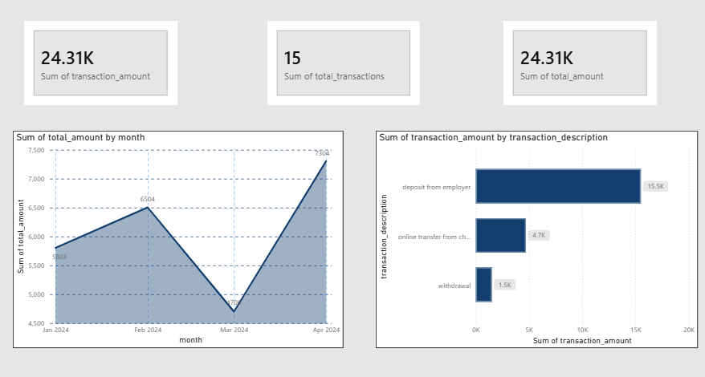

# Financial Transaction Analytics Pipeline & BI Dashboard.

An end-to-end ETL pipeline and Power BI dashboard for analyzing 
North America General Ledger transactions.

## Tech Stack
Python | PostgreSQL | SQLAlchemy | Pandas | Power BI | SQL

## Architecture
Raw CSV Files → Python ETL → PostgreSQL Database → SQL Views → Power BI Dashboard

## What it does
- Extracts raw financial transaction CSVs from multiple account sources
- Transforms and cleans data using Python (Pandas) — standardizing dates, 
  categories, and transaction types
- Loads into PostgreSQL data warehouse with Fact & Dimension tables
- SQL views for monthly trend analysis, anomaly detection, and account summaries
- Power BI dashboard tracking KPIs, expense trends, and high-value transactions 
  for North America General Accounting operations

## Dashboard Preview

## Project Structure
- `transactions_processing/` — Python ETL functions and processing notebooks
- `database_creation/` — SQL scripts for schema and dimension data
- `database_views/` — SQL views for financial analysis
- `dashboard/` — Power BI dashboard file (.pbix)

## How to Run
1. `pip install pandas sqlalchemy psycopg2-binary numpy`
2. Create `gl_transactions` database in PostgreSQL
3. Run `database_creation/final_database_creation_script.sql`
4. Run notebooks in `transactions_processing/`
5. Open `dashboard/gl_analytics_dashboard.pbix` in Power BI Desktop

## Key SQL Views
- `monthly_summary` — Monthly transaction totals by region
- `high_value_transactions` — Transactions exceeding threshold for anomaly review
- `account_summary` — Account-level aggregations and averages
