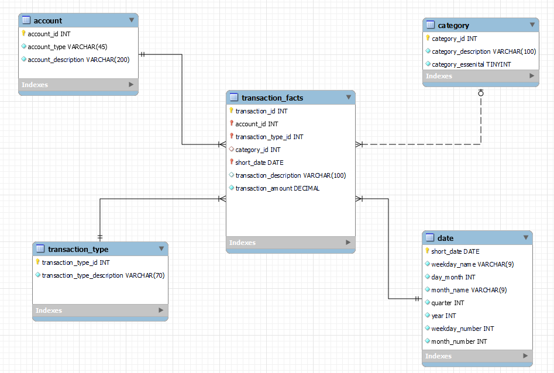

# Data Dictionary

## Schema



## Table Relationships

```
account ──────────────────────────┐
transaction_type ─────────────────┤──► transaction_facts
category (optional) ──────────────┤
date ─────────────────────────────┘
```

- Each row in `transaction_facts` references exactly one `account`, one `transaction_type`, and one `date`.
- `category_id` is nullable: only credit-card and debit purchases (`transaction_type_id` IN (1, 2)) are required to carry a category. All other transaction types leave `category_id` NULL.
- A `CHECK` constraint on `transaction_facts` enforces this rule at the database level.

---

## Table Descriptions

### `account` — Dimension Table

| Field               | Data Type    | Constraints             | Description                                             |
|---------------------|--------------|-------------------------|---------------------------------------------------------|
| account_id          | INT          | PRIMARY KEY             | Unique identifier for the account                       |
| account_type        | VARCHAR(45)  | NOT NULL                | Type of account: `checking`, `savings`, or `credit card`|
| account_description | VARCHAR(200) | NOT NULL                | Additional detail about the account                     |

---

### `transaction_type` — Dimension Table

| Field                       | Data Type   | Constraints             | Description                                        |
|-----------------------------|-------------|-------------------------|----------------------------------------------------|
| transaction_type_id         | INT         | PRIMARY KEY             | Unique identifier for the transaction type         |
| transaction_type_description| VARCHAR(70) | NOT NULL, UNIQUE        | Human-readable description of the transaction type |

**Reference values**

| ID | Description                                           |
|----|-------------------------------------------------------|
| 1  | credit card purchase                                  |
| 2  | debit card purchase                                   |
| 3  | deposit                                               |
| 4  | withdraw                                              |
| 5  | transfer sent                                         |
| 6  | transfer received                                     |
| 7  | credit card payment (positive — reduces owed balance) |
| 8  | credit card payment (negative — reduces bank balance) |
| 9  | interest payment                                      |
| 10 | miscellaneous                                         |
| 11 | fees & adjustments                                    |

---

### `category` — Dimension Table

| Field                | Data Type    | Constraints | Description                                                       |
|----------------------|--------------|-------------|-------------------------------------------------------------------|
| category_id          | INT (SERIAL) | PRIMARY KEY | Unique identifier for the category                                |
| category_description | VARCHAR(100) | NOT NULL    | Description of the category (e.g., `food & drink`, `groceries`)  |
| category_essential   | BOOLEAN      | NOT NULL    | `TRUE` if the category represents essential spending, else `FALSE`|

---

### `date` — Dimension Table

| Field          | Data Type  | Constraints | Description                                              |
|----------------|------------|-------------|----------------------------------------------------------|
| short_date     | DATE       | PRIMARY KEY | Date in `YYYY-MM-DD` format; unique identifier           |
| weekday_name   | VARCHAR(9) | NOT NULL    | Full weekday name (e.g., `Monday`)                       |
| day_month      | INT        | NOT NULL    | Day of the month (1–31)                                  |
| month_name     | VARCHAR(9) | NOT NULL    | Full month name (e.g., `January`)                        |
| quarter        | INT        | NOT NULL    | Quarter of the year (1–4)                                |
| year           | INT        | NOT NULL    | Four-digit year (e.g., `2024`)                           |
| weekday_number | INT        | NOT NULL    | Day of the week index (1 = Sunday, 7 = Saturday)         |
| month_number   | INT        | NOT NULL    | Month of the year (1–12)                                 |

---

### `transaction_facts` — Fact Table

| Field                   | Data Type       | Constraints                                     | Description                                                                                                       |
|-------------------------|-----------------|-------------------------------------------------|-------------------------------------------------------------------------------------------------------------------|
| transaction_id          | INT (SERIAL)    | PRIMARY KEY                                     | Auto-generated unique identifier for each transaction                                                             |
| account_id              | INT             | NOT NULL, FK → account.account_id               | The account the transaction belongs to                                                                            |
| transaction_type_id     | INT             | NOT NULL, FK → transaction_type.transaction_type_id | The type of transaction                                                                                       |
| category_id             | INT             | NULL, FK → category.category_id                 | Spending category; required for purchases (type 1 or 2), NULL for all other transaction types                     |
| short_date              | DATE            | NOT NULL, FK → date.short_date                  | Date the transaction posted                                                                                       |
| transaction_description | VARCHAR(100)    | NULL                                            | Bank-generated transaction description, truncated to 100 characters                                               |
| transaction_amount      | DECIMAL(12, 2)  | NOT NULL                                        | Transaction value. Negative for purchases and outflows; positive for deposits, transfers in, and CC payments      |

> [!NOTE]
> A `CHECK` constraint (`check_transaction_category`) ensures that any row with
> `transaction_type_id` IN (1, 2) must have a non-null `category_id`, while all
> other transaction types must leave `category_id` as NULL.
